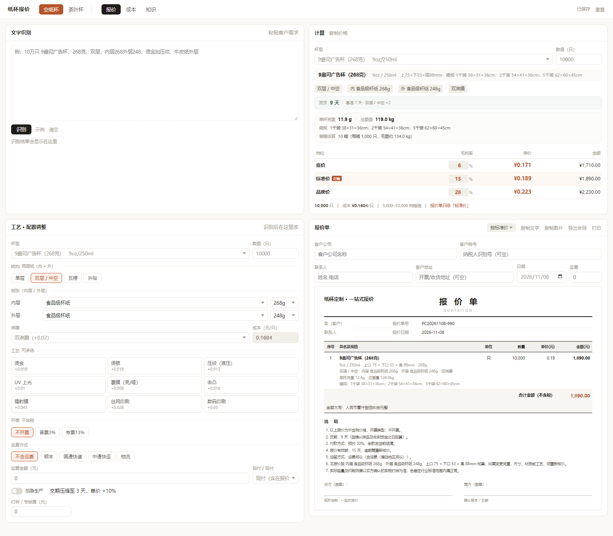
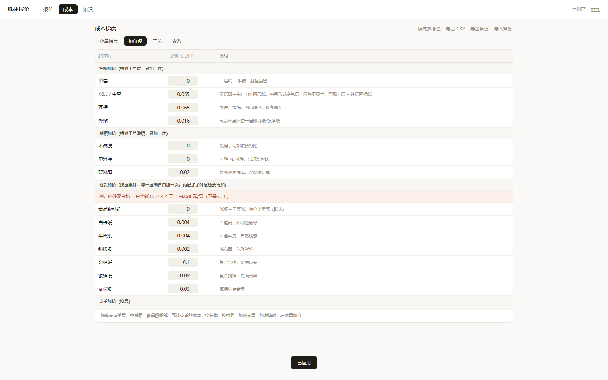
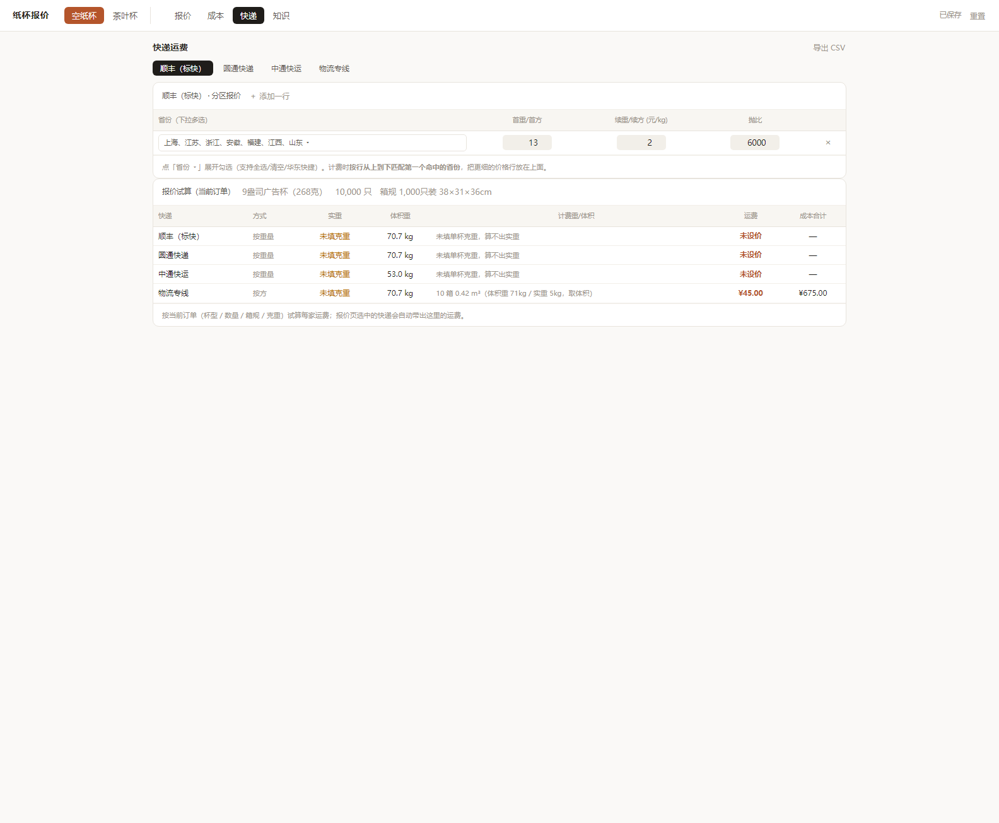
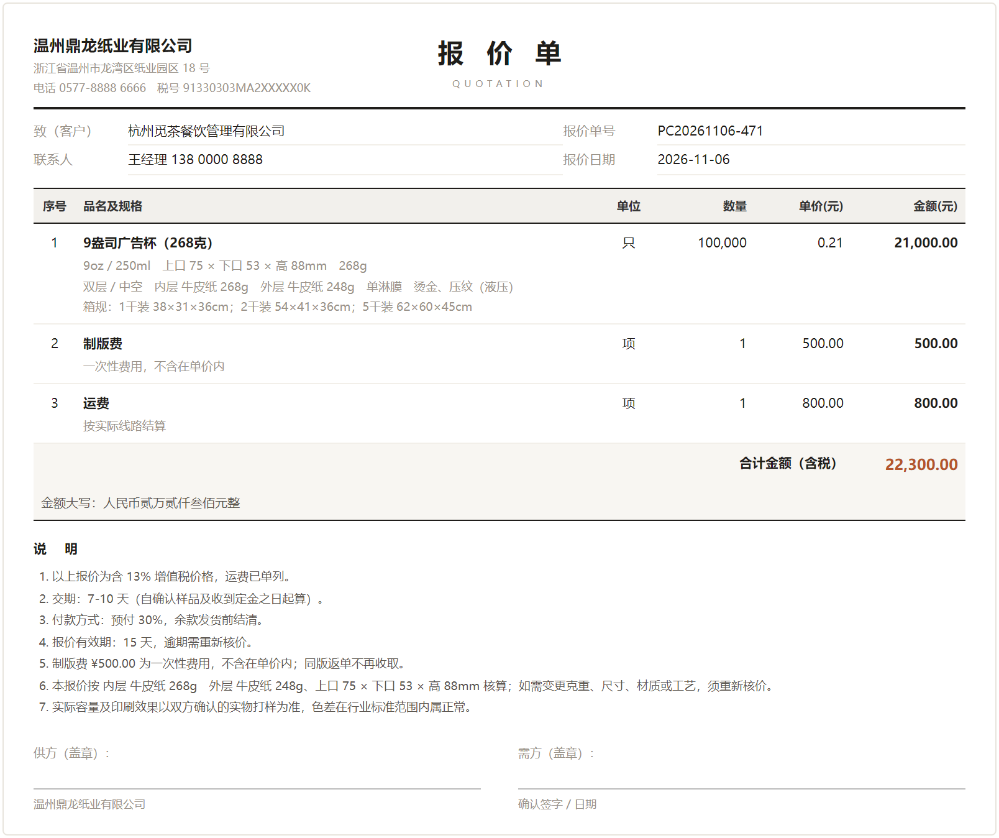
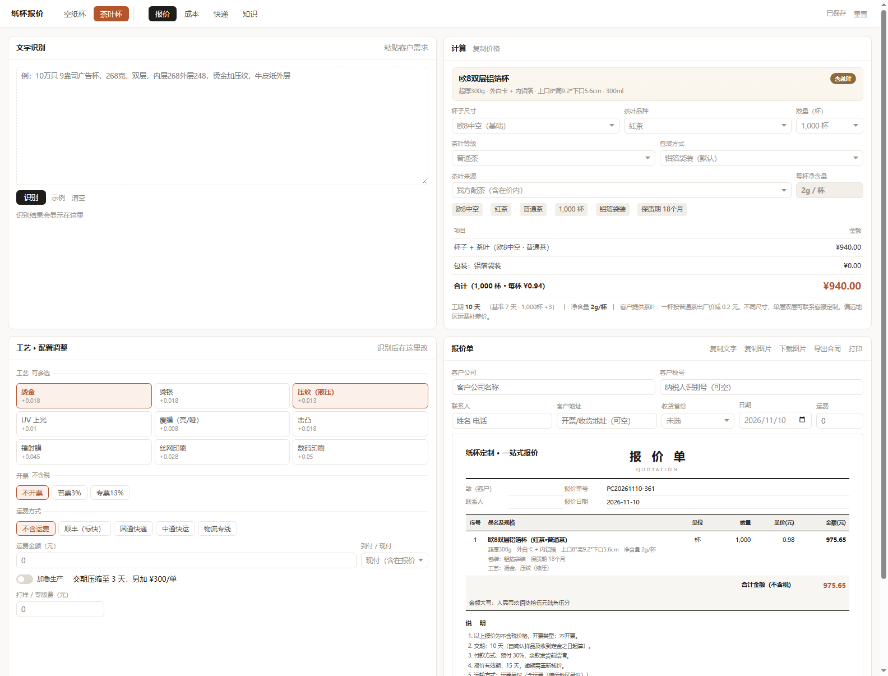
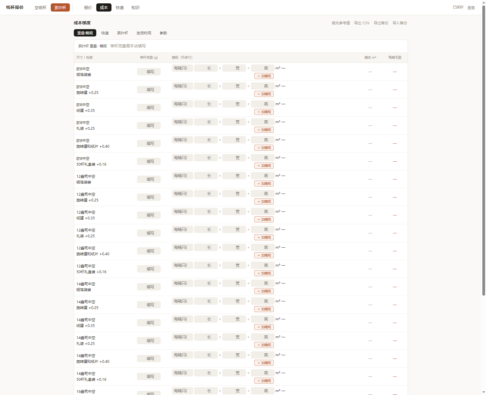

# 纸杯报价系统

> 纸杯工厂的报价与成本核算工具。纯静态网页，双击 `index.html` 就能用，不需要装软件、不需要联网。

一个给纸杯制造商量身做的报价工具。把成本梯度、加价规则、工艺费用、快递分区价一次性配好，之后每来一个客户询价，选杯型、填数量、勾工艺，30 秒出报价单和合同。



---

## 为什么做这个

纸杯报价的麻烦在于变量太多：

- 杯型 41 种，每种在不同数量档位的成本不一样
- 同一种杯型还能做单层、双层、中空、瓦楞、外贴
- 纸张有 7 种材质、克重从 198g 到 350g
- 工艺 9 种，每种都要单独算版费
- 客户还要分普通茶票、专票，价格不一样
- 运费按省份、按方还是按重量，每家快递都不一样

以前这些全靠 Excel 和计算器，一次报价要翻十几张表，还容易算错。

这个工具把整套逻辑固化下来，改一次数据，所有报价自动跟着变。

---

## 两个模式

| 模式 | 适用 |
|---|---|
| **空纸杯** | 广告杯、奶茶杯、中空杯、金箔铝箔杯、外贴银箔杯、纸桶、纸碗，共 41 个杯型 |
| **茶叶杯** | 欧8 / 12盎司 / 14盎司 / 16盎司双层铝箔杯 + 15 种茶叶 + 6 种包装的成品套装 |

顶栏一键切换，两套数据完全独立。

---

## 核心功能

### 报价

- 三种档位（底价 6% / 标准价 15% / 品牌价 28%），只把选中的那一档给客户看
- 客户永远看不到成本和毛利率
- 单价 = 成本 ÷ (1 − 毛利率) × (1 + 税点)，自动向上取整到厘

### 成本管理

| 表格 | 内容 |
|---|---|
| 数量梯度 | 41 杯型 × 5 个数量档位的单只成本，对数插值 |
| 加价项 | 结构（双层 +0.055 / 瓦楞 +0.065）、淋膜、材质、克重 |
| 工艺 | 9 种工艺按数量梯度定价，版费单独计 |
| 重量·箱规 | 单杯克重（实测填）+ 多行箱规（1千装 / 2千装 / 5千装） |
| 发货时间 | 基准 + 杯型 + 结构 + 工艺 累加 |
| 参数 | 公司信息、税率、加急费、合同标题 |

所有表格都支持**添加行 / 删除行 / 拖拽排序**。

| 数量梯度 | 重量 · 箱规 |
|---|---|
|  |  |

| 工艺 | 加价项 |
|---|---|
|  |  |

### 快递

独立页面，按快递公司分标签（顺丰 / 圆通 / 中通快运 / 物流专线）。

每家可以配多个价格区，每个区选一组省份，填首重、续重、抛重比。



计算遵循快递行业规则：

```
实重   = 单杯克重 × 数量 ÷ 1000 + 箱数 × 0.5kg
体积重 = 长×宽×高(cm) × 箱数 ÷ 抛重比
计费重 = max(实重, 体积重)        ← 泡货取大者
运费   = 首重 + (计费重 − 首重kg) × 续重
```

### 报价单

- 正式版式，含公司抬头、客户信息、明细表、金额大写、说明条款、签章位
- 支持**复制文字**、**复制图片**（直接粘微信）、**下载图片**、**打印 / 存 PDF**
- 支持填客户税号，自动出现在报价单和合同里



### 合同

- 导出**真正的 .docx**（不是改后缀的假 Word），Word / WPS 直接打开编辑
- 10 条定作合同条款，含质量标准（GB/T 27590-2022、GB 4806.8-2022）
- 导出前弹窗选：合同标题、发货时间、结算渠道（对公 / 微信电商 / 支付宝 / 银行卡）、付款节奏


### 文字识别

粘贴客户微信原话，自动提取数量、杯型、克重、结构、工艺、材质，生成**可编辑的确认清单**，改完一键应用。


支持口语化表达：

| 输入 | 识别结果 |
|---|---|
| 要十万个 12oz 中空杯 300g 的，UV上光 | 100000 只 / 12盎司中空杯 / 双层 / 300g / UV |
| 客户要 12盎司中空 双层 300克 一万五千只 加镭射 | 15000 只 / 12盎司中空杯 / 双层 / 300g / 镭射 |

纯规则引擎，不调 AI，离线可用，客户信息不出本机。

### 茶叶杯

4 个尺寸 × 6 种包装 × 15 种茶叶的成品套装报价，尺寸每升一档单杯 +0.05。

| 茶叶杯报价 | 茶叶杯 · 重量箱规 |
|---|---|
|  |  |

---

## 快速开始

```bash
# 方式一：直接打开
双击 index.html

# 方式二：本地起服务
python -m http.server 6655
# 访问 http://localhost:6655
```

**首次使用建议顺序：**

1. 成本 → 参数：填公司名、地址、电话、税号、开户行、账号
2. 成本 → 数量梯度：核对 41 个杯型的成本（默认值仅供参考）
3. 成本 → 加价项：按实际采购价改材质加价、克重加价
4. 成本 → 工艺：核对 9 种工艺的价格和版费
5. 成本 → 重量·箱规：填单杯克重（实测）和箱规
6. 快递：配每家快递的省份分区价
7. 开始报价

---

## 文档

| 文档 | 内容 |
|---|---|
| [使用说明.md](使用说明.md) | 完整功能说明、每个页面的用法 |
| [部署说明.md](部署说明.md) | Docker 构建、GitHub Actions、服务器部署 |
| [更新说明.md](更新说明.md) | 如何更新、回滚、数据兼容性 |
| [CHANGELOG.md](CHANGELOG.md) | 每个版本改了什么 |
| [VERSION.md](VERSION.md) | 当前版本号、兼容性说明 |

---

## 部署

### Docker

```bash
docker compose up -d --build
# 访问 http://localhost:6655
```

### 自动部署到服务器

推到 `main` 分支，GitHub Actions 自动：

1. 构建镜像 → 推送到 GHCR
2. SSH 连服务器 → 拉镜像 → 重启容器 → 健康检查

详细步骤见 [部署说明.md](部署说明.md)。

---

## 技术说明

| 项目 | 说明 |
|---|---|
| 技术栈 | 原生 HTML / CSS / JavaScript，**零依赖** |
| 构建 | 无。不需要 npm、webpack、vite |
| 存储 | localStorage（浏览器本地） |
| 合同生成 | 自研 DOCX 生成器（ZIP + OOXML，纯 JS） |
| 图片导出 | Canvas 2D 手绘 |
| 离线 | 完全可用，不加载任何 CDN |
| 浏览器 | Chrome / Edge（推荐最新版） |

**为什么不用框架？**

因为这个工具要能「双击就打开」。加了构建步骤，工厂里的电脑就得多装 Node.js，反而增加使用门槛。

---

## 目录结构

```
paper-cup-quotation-system/
├── index.html              # 主页面（三个 Tab：报价 / 成本 / 快递）
├── assets/
│   ├── data.js             # 杯型、材质、工艺、快递等基础数据
│   ├── app.js              # 全部业务逻辑
│   ├── docx.js             # DOCX 生成器（ZIP + OOXML）
│   └── style.css           # 样式
├── docs/images/            # 界面截图
├── deploy/
│   └── nginx.conf          # nginx 配置
├── Dockerfile
├── docker-compose.yml
├── .github/workflows/
│   └── deploy.yml          # CI/CD
├── 使用说明.md              # 完整功能文档
└── 部署说明.md              # 部署步骤
```

---

## 数据说明

**内置的杯型、克重、箱规**来自真实价格表（鼎龙 2023 / 业务员 2025-10-18 / 温州揽胜）。

**成本、加价、运费、税点**基于行业常见水平估算，**仅供参考，上线前必须替换成你的实际数据**。

⚠️ 尤其是快递首重续重、材质加价、工艺版费这三项，不同地区、不同供应商差异很大。

---

## 已知限制

- 单杯克重需手动填（不做自动估算，避免误差）
- 茶叶杯的箱规需按「尺寸 × 包装」24 个组合逐个填
- 文字识别是规则引擎，非常规表达可能识别不全（会提示手动补充）
- 数据存 localStorage，换浏览器 / 清缓存会丢失，建议定期「导出备份」

---

## License

MIT

