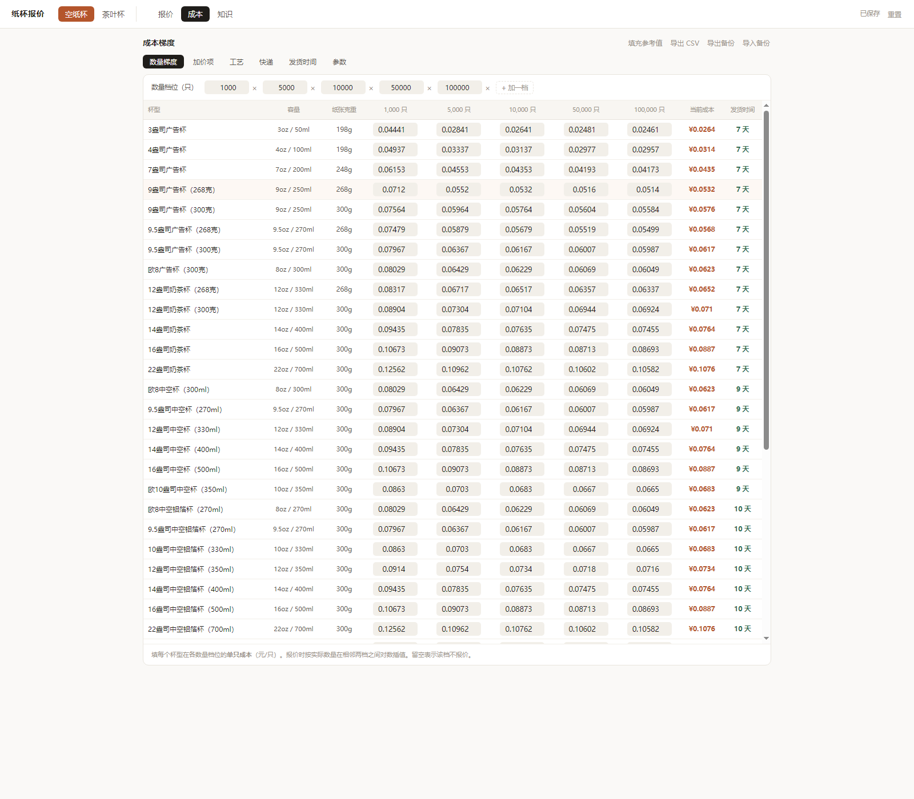
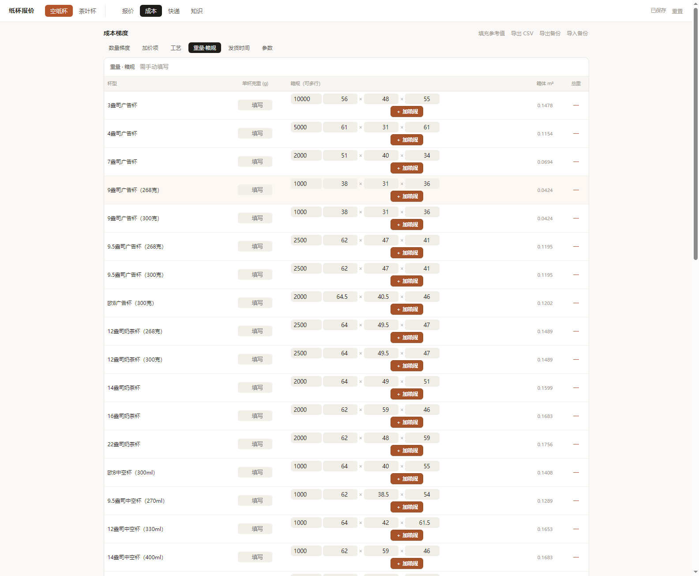
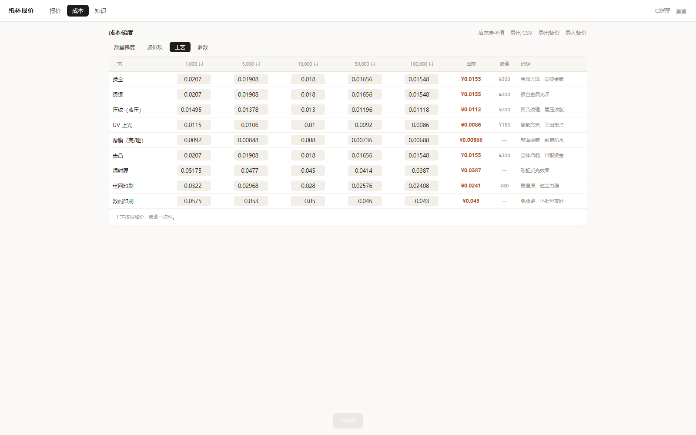
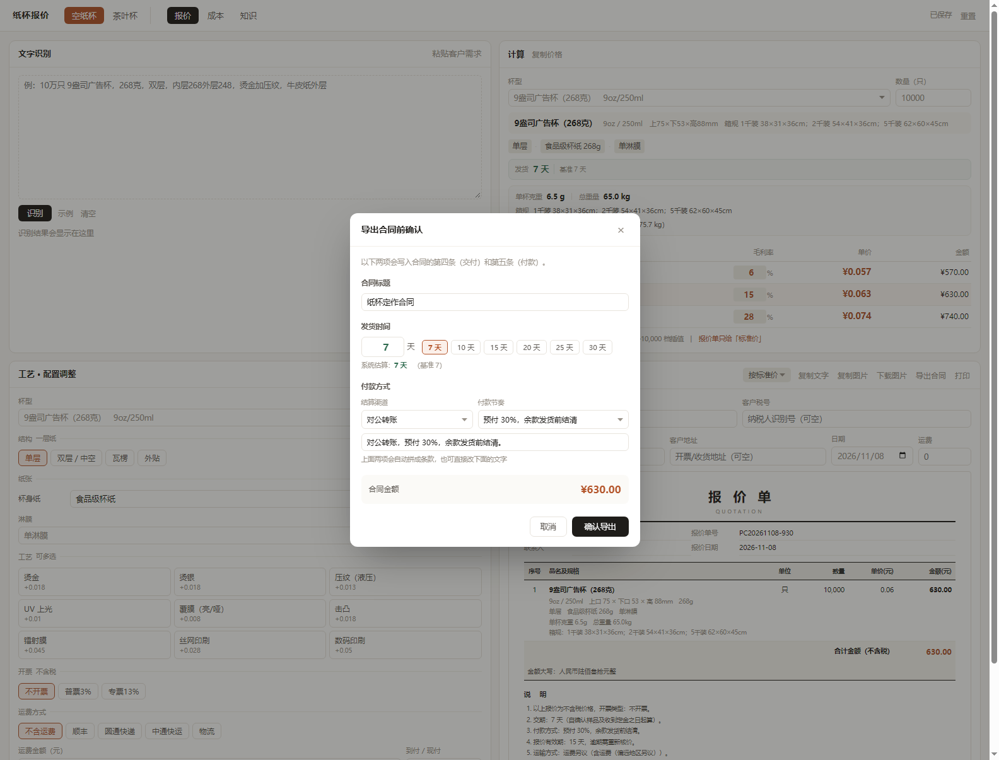
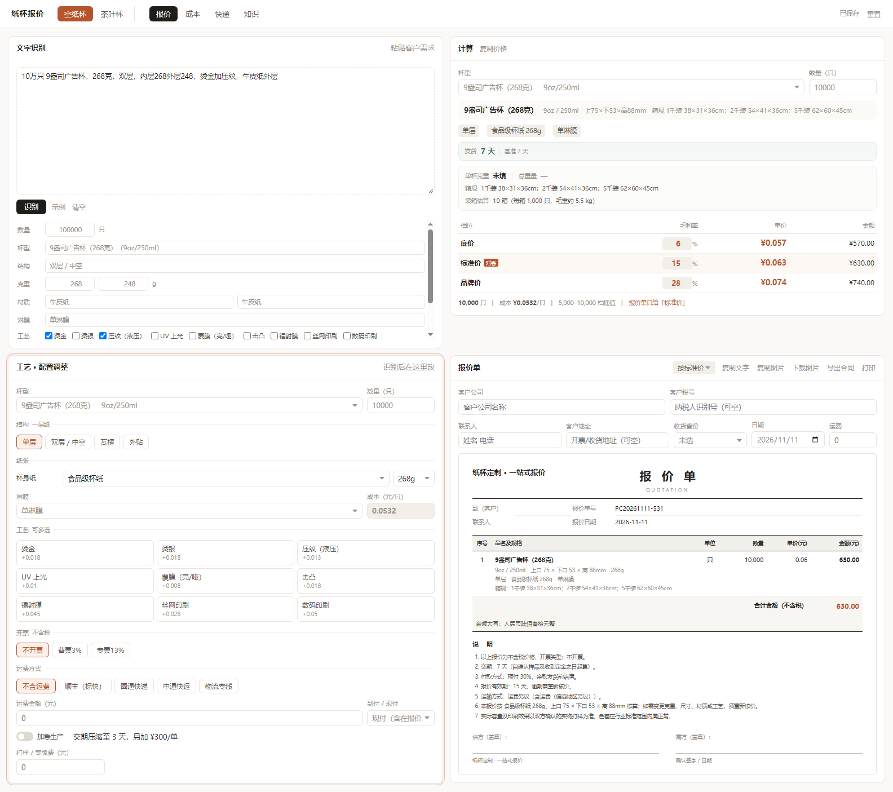

# 纸杯报价系统

> 纸杯工厂的报价与成本核算工具。纯静态网页，双击 `index.html` 就能用，不需要装软件、不需要联网。

一个给纸杯制造商量身做的报价工具。把纸库、成本梯度、加工费、工艺费用、快递分区价一次性配好，之后每来一个客户询价，选杯型、填数量、勾工艺，30 秒出报价单和合同。


---

## 为什么做这个

纸杯报价的麻烦在于变量太多：

- 杯型 41 种，每种在不同数量档位的成本不一样
- 同一种杯型还能做单层、双层、中空、瓦楞、外贴
- 纸库按本厂开料拼数表预置，每个杯型默认用自己的开料纸，拼版数自动算
- 工艺 9 种，每种都要单独算版费
- 客户还要分普通茶票、专票，价格不一样
- 运费按省份、按方还是按重量，每家快递都不一样

以前这些全靠 Excel 和计算器，一次报价要翻十几张表，还容易算错。

这个工具把整套逻辑固化下来，改一次数据，所有报价自动跟着变。

---

## 两个模式

| 模式 | 适用 |
|---|---|
| **空纸杯** | 广告杯、奶茶杯、中空杯、金箔铝箔杯、外贴银箔杯，共 31 个杯型 |
| **茶叶杯** | 欧8 / 12盎司 / 14盎司 / 16盎司双层铝箔杯 + 15 种茶叶 + 6 种包装的成品套装 |

顶栏一键切换，两套数据完全独立。

---

## 核心功能

### 报价

- 三种档位（底价 6% / 标准价 15% / 品牌价 28%），只把选中的那一档给客户看
- 客户永远看不到成本和毛利率
- 单价 = 成本 ÷ (1 − 毛利率) × (1 + 税点)，自动向上取整到厘

### 成本管理

成本页里管纸的部分拆成两个标签：**「纸」**（纸库 + 工艺参数）和 **「纸杯」**（每个杯型选纸、选结构、填拼版与损耗）。

| 标签 | 内容 |
|---|---|
| **纸** | 纸库表：一行 = 一张纸，字段 = 名称 / 长(mm) / 宽(mm) / 克重(g/m²) / 吨价(元/吨) / 说明，**支持添加、删除、改**；工艺参数只保留「默认损耗 %」（卷边系数、杯底余量固定，买的是淋膜纸，PE 涂膜含在纸价里） |
| **纸杯** | 每个杯型一块：**结构**下拉（单层 / 双层·中空 / 瓦楞 / 外贴）+ 层行；每层选纸、填拼版与损耗，自动算出杯身重 / 杯身成本 / 底片重 / 底片成本 / 层重，以及该杯型的**单杯总重**和**单只纸价** |
| **加工** | 成型、印刷按数量梯度定价（对数插值） |
| 工艺 | 9 种工艺按数量梯度定价，版费单独计 |
| 重量·箱规 | 自动克重（按纸杯表算）+ 实测克重（可覆盖）+ 多行箱规（1千装 / 2千装 / 5千装） |
| 发货时间 | 基准 + 杯型 + 结构 + 工艺 累加 |
| 参数 | 公司信息、税率、加急费、合同标题 |

所有表格都支持**添加行 / 删除行 / 拖拽排序**。

**纸库预置 33 行**：开料纸（口杯纸 850×485、825×530、850×530、850×590、900×485、900×555、750×485、750×515、750×565、700×480、700×490、880×485 等，铝箔纸 682×485、682×585、700×485、850×535，金箔纸 850×535，银箔纸 700×490），外加 787×1092 的通用整张纸（口杯纸 198/248/268/300g、铝箔纸、金箔纸、银箔纸、白卡纸 300g、瓦楞纸 268g）。名称带「通用」的整张纸才会被自动匹配给杯型；开料纸只给开料表里对应的杯型用，别的杯型不会被错配。

### 纸成本怎么算（核心）

**不再手填每个杯型的单只成本**，改成从纸的物理参数算：

```
整张纸钱(元/张) = 长(m) × 宽(m) × 克重(g/m²) ÷ 1000 (kg) × 吨价 ÷ 1000 (元/kg)
有效拼版        = 拼版数 × (1 − 损耗%)        ← 损耗 8% → 有效系数 0.92
杯身纸成本      = 整张纸钱 ÷ 有效拼版
杯底纸成本      = 净面积 × 克重 ÷ 1000 × 吨价 ÷ 1000 ÷ (1 − 损耗%)
单只纸成本      = Σ各层(杯身纸成本) + 内杯杯底纸成本
单只成本        = 纸 + 加工费(成型+印刷) + 工艺费    ← 淋膜含在纸价里
报价            = 成本 ÷ (1 − 毛利率) × (1 + 税率)
```

- **纸库**：一行 = 一张纸。长×宽决定能排多少扇片，克重决定杯重，吨价决定纸钱。新加的纸不会自动套到杯型上，到「纸杯」表里给对应杯型选它。删掉正在用的纸会自动改用列表第一张。
- **工艺参数**：只保留「默认损耗 %」（默认 8）。卷边系数固定 1.06、杯底余量固定 4mm；买的是淋膜纸，**PE 涂膜含在纸价里，淋膜不再单独计**。
- **杯身扇片**：宽 = 上口周长 × 卷边 1.06，高 = 斜高 sqrt(高² + ((上口−下口)/2)²)；相邻两片**一正一倒相扣**排：横向节距 =（上口周长 + 下口周长）÷ 2，第一片占整个上口周长；每行高度内层 = 斜高 + 14mm 卷边余量，外层（中空外筒 / 外贴面纸）= 斜高。两个方向各排一遍取大 = 拼版数。
- **杯底圆片**：**卷筒纸切圆片，不排版**，直径 = 下口 + 4mm，按净面积 × 克重 × 吨价 ÷ (1 − 损耗%) 计；**只有内杯有底，外杯（杯套）没有底**。
- **按层累计**：双层 / 瓦楞 / 外贴在纸杯表里是**两行**（内杯 + 外杯），各用各的纸、拼版与损耗，纸价相加。**结构不再单列工费**——层数与纸价自动算进成本。
- **单杯重量** = Σ各层(扇片净面积 × 克重) + 内杯底片净重（净重，不含损耗）。

**三个杯型算例**（单层、食品级杯纸 6800 元/吨、整张 787×1092mm、损耗 8%、卷边 1.06、杯底余量 4mm）：

| 杯型 | 扇片尺寸 | 拼版 | 杯底直径 | 纸价（元/只） | 单杯重量（g） |
|---|---|---|---|---|---|
| 4盎司广告杯（198g，杯口60×底45×高60） | 200×60mm | 65 | 49mm | ≈ **0.0221** | ≈ **2.47** |
| 9盎司广告杯（268g，杯口75×底53×高88） | 250×89mm | 36 | 57mm | ≈ **0.0523** | ≈ **5.75** |
| 22盎司奶茶杯（300g，杯口90×底58×高168） | 300×169mm | 12 | 62mm | ≈ **0.1655** | ≈ **13.38** |

纸价 = 杯身纸成本 + 杯底纸成本，杯底按**卷筒纸净面积**计（不排版）；单杯重量为净重（不含损耗、不含淋膜）。大杯和小杯的纸耗差了 7 倍，现在是从几何尺寸算出来的，不需要再逐个填表。

> ⚠️ 自动拼版按**方排**估算。实际印厂常做错缝/蜂窝排片，能塞更多。**如果你手上有实际排版数，直接在成本页「纸杯」表的「拼版数」列填进去**，系统会用你的值覆盖自动值（留空 = 回到自动）。这是校准成本最管用的一步。

### 各处联动

| 位置 | 显示 |
|---|---|
| 报价页「纸张」行 | **只读摘要**：内杯/外杯用的纸、克重、拼版、损耗；改配置点旁边的「**去成本页改纸 / 拼版 / 损耗 →**」 |
| 报价页结构切换 | 仍然能切（单层 / 双层·中空 / 瓦楞 / 外贴），切换会写回纸杯表里该杯型的配置 |
| 重量·箱规 | 新增「**自动克重**」列（按纸杯表算），实测克重手填可覆盖；总重与运费按生效克重算 |
| 成本构成提示 | 显示每层的纸名 / 克重 / 吨价 / 拼版 / 损耗 |
| 导出 | 「**导出纸杯成本表**」CSV：每层的纸、克重、拼版、损耗、杯身重、杯身成本、底片重、底片成本、单杯重、单只纸价 |
| 备份 | JSON 版本 v5，含 `paperStock`（纸库）与 `cupPaper`（纸杯配置） |

| 成本 · 纸 / 纸杯 | 重量 · 箱规 |
|---|---|
|  |  |

| 工艺 | 纸杯 |
|---|---|
|  |  |

### 快递

独立页面，按快递公司分标签（顺丰 / 圆通 / 中通快运 / 物流专线）。

每家可以配多个价格区，每个区选一组省份，填首重、续重、抛重比。


计算遵循快递行业规则：

```
实重   = 单杯克重 × 数量 ÷ 1000 + 箱数 × 0.5kg
体积重 = 长×宽×高(cm) × 箱数 ÷ 抛重比
计费重 = max(实重, 体积重)        ← 泡货取大者
运费   = 首重 + (计费重 − 首重kg) × 续重
```

### 报价单

- 正式版式，含公司抬头、客户信息、明细表、金额大写、说明条款、签章位
- 支持**复制文字**、**复制图片**（直接粘微信）、**下载图片**、**打印 / 存 PDF**
- 支持填客户税号，自动出现在报价单和合同里


### 合同

- 导出**真正的 .docx**（不是改后缀的假 Word），Word / WPS 直接打开编辑
- 10 条定作合同条款，含质量标准（GB/T 27590-2022、GB 4806.8-2022）
- 导出前弹窗选：合同标题、发货时间、结算渠道（对公 / 微信电商 / 支付宝 / 银行卡）、付款节奏



### 文字识别

粘贴客户微信原话，点「识别」**直接套用到报价**：数量、杯型、克重、结构、工艺、材质全部落到下方「工艺 · 配置调整」面板里，用下拉随手改即可。



支持口语化表达：

| 输入 | 识别结果 |
|---|---|
| 要十万个 12oz 中空杯 300g 的，UV上光 | 100000 只 / 12盎司中空杯 / 双层 / 300g / UV |
| 客户要 12盎司中空 双层 300克 一万五千只 加镭射 | 15000 只 / 12盎司中空杯 / 双层 / 300g / 镭射 |

纯规则引擎，不调 AI，离线可用，客户信息不出本机。

### 茶叶杯

4 个尺寸 × 6 种包装 × 15 种茶叶的成品套装报价，尺寸每升一档单杯 +0.05。

| 茶叶杯报价 | 茶叶杯 · 重量箱规 |
|---|---|
|  |  |

---

## 快速开始

```bash
# 方式一：直接打开
双击 index.html

# 方式二：本地起服务
python -m http.server 6655
# 访问 http://localhost:6655
```

**首次使用建议顺序：**

1. 成本 → 参数：填公司名、地址、电话、税号、开户行、账号
2. 成本 → 纸：核对纸库（长宽 / 克重 / 吨价）与默认损耗 %（纸价已含淋膜，不用再算 PE）
3. 成本 → 纸杯：给每个杯型选纸、选结构，核对拼版（自动按方排算，建议改成印厂实测排版数）
4. 成本 → 加工：按实际开机 / 印刷费改加工梯度
5. 成本 → 工艺：核对 9 种工艺的价格和版费
6. 成本 → 重量·箱规：填箱规；单杯克重自动算，有实测值可覆盖
7. 快递：配每家快递的省份分区价
8. 开始报价

---

## 文档

| 文档 | 内容 |
|---|---|
| [使用说明.md](使用说明.md) | 完整功能说明、每个页面的用法 |
| [部署说明.md](部署说明.md) | Docker 构建、GitHub Actions、服务器部署 |
| [更新说明.md](更新说明.md) | 如何更新、回滚、数据兼容性 |
| [CHANGELOG.md](CHANGELOG.md) | 每个版本改了什么 |
| [VERSION.md](VERSION.md) | 当前版本号、兼容性说明 |

---

## 部署

### Docker

```bash
docker compose up -d --build
# 访问 http://localhost:6655
```

### 自动部署到服务器

推到 `main` 分支，GitHub Actions 自动：

1. 构建镜像 → 推送到 GHCR
2. SSH 连服务器 → 拉镜像 → 重启容器 → 健康检查

详细步骤见 [部署说明.md](部署说明.md)。

---

## 技术说明

| 项目 | 说明 |
|---|---|
| 技术栈 | 原生 HTML / CSS / JavaScript，**零依赖** |
| 构建 | 无。不需要 npm、webpack、vite |
| 存储 | localStorage（浏览器本地） |
| 合同生成 | 自研 DOCX 生成器（ZIP + OOXML，纯 JS） |
| 图片导出 | Canvas 2D 手绘 |
| 离线 | 完全可用，不加载任何 CDN |
| 浏览器 | Chrome / Edge（推荐最新版） |

**为什么不用框架？**

因为这个工具要能「双击就打开」。加了构建步骤，工厂里的电脑就得多装 Node.js，反而增加使用门槛。

---

## 目录结构

```
cup-quote/
├── index.html              # 主页面（三个 Tab：报价 / 成本 / 快递）
├── assets/
│   ├── data.js             # 杯型、材质、工艺、快递等基础数据
│   ├── app.js              # 全部业务逻辑
│   ├── docx.js             # DOCX 生成器（ZIP + OOXML）
│   └── style.css           # 样式
├── docs/images/            # 界面截图
├── deploy/
│   └── nginx.conf          # nginx 配置
├── Dockerfile
├── docker-compose.yml
├── .github/workflows/
│   └── deploy.yml          # CI/CD
├── 使用说明.md              # 完整功能文档
└── 部署说明.md              # 部署步骤
```

---

## 数据说明

**内置的杯型、克重、箱规**来自真实价格表（鼎龙 2023 / 业务员 2025-10-18 / 温州揽胜）。

**成本、加价、运费、税点**基于行业常见水平估算，**仅供参考，上线前必须替换成你的实际数据**。

⚠️ 尤其是快递首重续重、材质加价、工艺版费这三项，不同地区、不同供应商差异很大。

---

## 已知限制

- 自动拼版按**方排**估算，实际错缝/蜂窝排片请在「纸杯」表填实测值，否则纸成本可能偏高
- 单杯克重按纸杯表自动算出（净重，不含淋膜），实测值可在「重量·箱规」覆盖
- 茶叶杯的箱规需按「尺寸 × 包装」24 个组合逐个填
- 文字识别是规则引擎，非常规表达可能识别不全（会提示手动补充）
- 数据存 localStorage，换浏览器 / 清缓存会丢失，建议定期「导出备份」

---

## License

MIT

